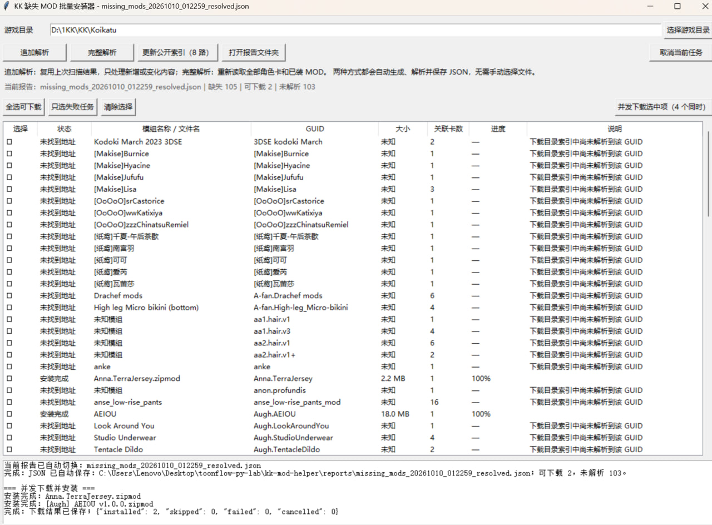

# KK 缺失 MOD 批量安装器

一个面向 **Koikatu（KK）** 玩家的缺失 MOD 检测和批量安装工具。它会扫描人物卡、坐标卡和 Studio 场景，找出缺失的 Sideloader `.zipmod`，然后帮你批量下载并放到正确位置。

> [!IMPORTANT]
> 普通用户请直接使用 **EXE 便携版**，不需要安装 Python，也不需要手动选择 JSON 报告。

## 下载 EXE

1. 打开 [Releases 下载页](https://github.com/ZBWzhao/kk-mod-helper/releases/latest)。
2. 在 **Assets** 中下载 `KK-Mod-Helper.exe`。
3. 在 D 盘或 E 盘新建一个普通文件夹，例如 `D:\KK-Mod-Helper`，再把 EXE 放进去。
4. 双击 `KK-Mod-Helper.exe` 启动。

请不要把 EXE 直接放在 `Program Files`、压缩包内部或只读目录中。程序会在 EXE 旁边自动创建 `data` 和 `reports` 文件夹。

## 界面预览



## 小白使用流程

### 1. 选择游戏目录

点击右上角的 **“选择游戏目录”**，选择 Koikatu 的根目录，也就是里面能看到 `Koikatu.exe`、`UserData` 和 `mods` 的文件夹。

例如：

```text
D:\Games\Koikatu
```

程序会记住你选择的游戏目录，下次启动通常不需要重新选择。

### 2. 首次更新公开索引

首次使用时，建议先点击 **“更新公开索引（8 路）”**。工具会获取公开的 BetterRepack KKEC 文件列表。

- 这一步需要联网，首次耗时可能较长。
- 更新过程中不要重复点击按钮。
- 以后只需在长时间未使用或解析不到新 MOD 时再更新。

### 3. 检测缺失 MOD

第一次使用请点击 **“完整解析”**。程序会：

1. 扫描 `UserData` 中的人物卡、坐标卡和 Studio 场景。
2. 检查 `mods` 中已安装的 MOD。
3. 自动生成缺失 MOD 的 JSON 报告。
4. 自动解析下载地址并载入任务表。

之后新增了人物卡或场景卡时，优先使用 **“追加解析”**，速度会更快。只有当结果明显不对、更换了游戏目录或需要重新检查全部文件时，再使用完整解析。

### 4. 选择并下载

- 如果只想补齐某一张场景卡，先点击 **“选择场景卡…”**。左侧支持勾选一张或多张场景卡，单击卡片时右侧会显示场景卡图片。
- 应用场景卡筛选后，主列表会同时显示这些卡使用的全部 zipmod：已经安装的项目标为 **“已安装”**，尚缺少的项目会显示为 **“等待下载”** 或 **“未找到地址”**。
- 此时点击 **“全选可下载”**，只会勾选当前所选场景卡缺失且能下载的 MOD，不会下载其他卡片的 MOD。
- 点击 **“显示全部缺失 MOD”** 可退出场景卡筛选，回到原来的总缺失列表。
- 点击 **“全选可下载”**，选中已找到地址的 MOD。
- 需要自己选择时，用 `Ctrl+单击` 挑选多个模组，或用 `Shift+单击` 选中连续的多行。
- 多行高亮后，点击 **“勾选高亮项”** 加入下载列表；点击 **“取消高亮项”** 移出。按空格键也可批量切换勾选状态。
- 单击表格第一列的 `☐` 可直接勾选或取消该模组。`—` 表示该项已安装或尚未解析到下载地址，不能加入下载任务；只有第一列显示 `☑` 的模组才会被下载。
- 高亮一行或多行后，点击 **“复制模组名称”** 或按 `Ctrl+C`，可一次复制多个名称，每个名称单独一行。
- 在高亮任务上点击右键，还可批量复制 GUID 或“名称 + GUID”，方便手动搜索或提交问题。
- 点击 **“并发下载选中项（4 个同时）”** 开始下载和安装。

下载完成后，`.zipmod` 会自动放到：

```text
<游戏目录>\mods\ModResolver_Downloads\<网站分类>\
```

不需要解压 `.zipmod`。安装完成后，重新启动游戏即可让 Sideloader 读取新 MOD。

### 5. 处理失败任务

如果某些任务下载失败：

1. 点击 **“只选失败任务”**。
2. 再点击 **“并发下载选中项”** 重试。
3. 如果仍然失败，打开报告文件夹，保留错误日志后到 GitHub 提交问题。

工具会保留失败记录，重新启动后仍可查看和重试。

## 常见状态说明

| 状态 | 含义 | 建议 |
| --- | --- | --- |
| 可下载 | 已找到 MOD 地址 | 可以勾选并下载 |
| 已安装 | 所选场景卡需要该 MOD，但游戏中已经存在 | 无需重复下载 |
| 安装完成 | MOD 已下载并放到游戏目录 | 无需重复下载 |
| 未找到地址 | 公开索引中暂时无法确定对应文件 | 更新公开索引后再追加解析 |
| 下载失败 | 网络中断、服务器拒绝或文件验证失败 | 使用“只选失败任务”重试 |

`catalog.json` 不需要手动创建。它不存在时，程序会从空索引开始，并在解析过程中自动创建和逐步补全。

## 安全说明

- 不会删除现有 MOD，不会覆盖同名文件。
- 只会自动安装 Sideloader `.zipmod`，不会安装 BepInEx 插件 DLL。
- 无法可靠解析的 GUID 会保留为“未找到地址”，程序不会猜测下载或强行安装。

## 遇到问题

请前往 [GitHub Issues](https://github.com/ZBWzhao/kk-mod-helper/issues) 提交问题，并尽量附上：

- 工具版本和 Windows 版本。
- 使用的是“追加解析”还是“完整解析”。
- 完整错误文字或截图。
- 能够重现问题的操作步骤。

> 请不要在 Issue 中公开上传个人账号、Cookie、Token 或含有私人内容的角色卡/场景卡。

## 开发者使用

以下内容只适合希望从源码运行的用户。

图形界面可通过 `run_gui.cmd` 启动。首次启动会在项目目录创建独立的 `.venv` 并安装 `msgpack`，不会修改游戏的 Python 环境。需要重新打包时，双击 `build_portable.cmd`。

## 命令行

创建环境：

```powershell
python -m venv .venv
.\.venv\Scripts\python.exe -m pip install -r requirements.txt
```

初始化当前目录映射：

```powershell
.\.venv\Scripts\python.exe -m kk_mod_helper.cli bootstrap `
  --report "<现有缺失模组报告.json>" `
  --url-cache "<现有公开 URL 索引.json>"
```

扫描：

```powershell
.\.venv\Scripts\python.exe -m kk_mod_helper.cli scan --game "<游戏目录>"
```

解析下载地址：

```powershell
.\.venv\Scripts\python.exe -m kk_mod_helper.cli resolve `
  --report ".\reports\missing_mods_时间.json" `
  --url-cache ".\data\KKEC_urls.json"
```

安装必须明确确认：

```powershell
.\.venv\Scripts\python.exe -m kk_mod_helper.cli install `
  --game "<游戏目录>" `
  --report ".\reports\missing_mods_时间_resolved.json" `
  --confirm INSTALL
```

## 解析策略与限制

- 已知 GUID 优先从本地 `catalog.json` 精确解析。
- 现有报告包含文件名时，按文件名和分类精确匹配公开文件索引。
- 新 GUID 可以通过 HTTP Range 只读取远程 zipmod 的中央目录和 `manifest.xml`，不必下载整个文件进行识别。
- 图形界面解析下载地址使用 8 路并发，每个 GUID 最多选择 5 个高相关候选，全局最多探测 40 个文件。
- 公开 URL 索引使用 8 路并发更新，并降低界面日志刷新频率；更新中断时会合并保留旧索引。
- 下载使用 4 路并发，支持 `.partial` 断点续传；每个失败任务自动尝试 3 次。
- 无法可靠解析的 GUID 会保留为 `not_found`，不会猜测下载或安装。
- 第一版只处理 Sideloader `.zipmod`；不会自动安装 BepInEx 插件 DLL。

相关公开格式参考：

- [IllusionMods/BepisPlugins Sideloader manifest 实现](https://github.com/IllusionMods/BepisPlugins/blob/master/src/Core_Sideloader/Core.Sideloader.Manifest.cs)
- [IllusionMods/KKManager](https://github.com/IllusionMods/KKManager)
- [BetterRepack KKEC 公开目录](https://sideload.betterrepack.com/download/KKEC/)
